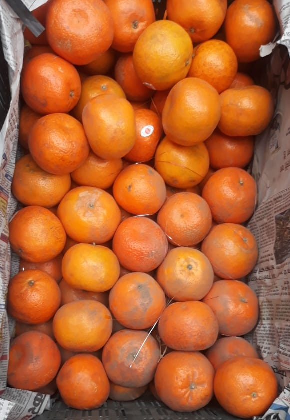

# Lab 04 — Watershed Segmentation

## Introduction

<p align="center">
  
  <br><em>The box of oranges used in this lab (<code>Data/Oranges_in_a_box_crop.jpg</code>).</em>
</p>

How many oranges are in the box? The oranges are picked out well when the photo is thresholded — but where oranges touch, their white regions are joined, and the whole box is reduced to just a few large connected blobs. A count of the blobs gives the wrong answer.

This problem is solved by the **Watershed** algorithm. The image is treated as a landscape and is flooded with water from a set of **markers** — one starting point per object. Where water from two different markers meets, a wall is built: a boundary between two objects. The key requirement is one good marker per orange, and these are obtained from the **Distance Transform**, by which every orange is turned into a hill whose peak is at the orange's centre — even when the orange is touching its neighbours.

The lab is based on the [OpenCV watershed tutorial](https://docs.opencv.org/4.x/d3/db4/tutorial_py_watershed.html).

The lab is split into ten small steps. Each step is one short method — usually a single OpenCV call — and each one can be checked before the next is started.

## Dataset / Test Images

| Resource | Details |
|----------|---------|
| `Oranges_in_a_box_crop.jpg` | About 30 oranges packed tightly in a box lined with newspaper (581 × 840 pixels). Cropped (the plastic crate at the bottom removed) from ["Oranges in a Box"](https://commons.wikimedia.org/wiki/File:Oranges_in_a_Box.jpg) by Sidheeq, licensed [CC BY-SA 3.0](https://creativecommons.org/licenses/by-sa/3.0); the cropped version is shared under the same licence. Located in `Data/`. |

## How This Lab Works

1. **One step** is implemented in `lab04.py`.
2. `python evaluate_lab04.py` is run. Every finished step is run, a figure for each one is added to `lab04_results.html`, and the script stops at the first step that has not yet been implemented.
3. `lab04_results.html` is opened and the new figure is checked before the next step is started.

`pytest test_lab04.py` can also be run at any point — the tests are grouped by step, so the step that needs attention is indicated by the failing tests.

> **Image coordinates:** NumPy arrays are indexed `image[row, col]`, with row 0 at the **top**. Points are passed to OpenCV drawing functions such as `cv2.circle` as `(x, y)` = `(col, row)` — the other way round. Both conventions are used in Step 6, so care is needed with the order.

## The Pipeline at a Glance

```
colour image
  → 1. colour_channel      red minus blue: oranges bright, newspaper and gaps dark
  → 2. threshold           oranges white, everything else black (touching oranges merge)
  → 3. remove_noise        small speckle removed
  → 4. background_mask     what is certainly not an orange (the background marker)
  → 5. distance_transform  one "hill" per orange, peak at its centre
  → 6. orange_markers      one small marker at each peak (local maximum)
  → 7. unknown_region      the zone watershed has to decide
  → 8. create_markers      one label per marker
  → 9. apply_watershed     flood from the markers over the colour image
  → 10. segment            runs steps 1–9 in order
```

## Background

### A colour channel instead of greyscale
In most thresholding examples the image is first converted to greyscale. That does not work well here: the newspaper lining is *brighter* than the oranges, so it would be counted as foreground. The oranges are distinguished by their **colour** — lots of red, little blue — while the newspaper, the crate and the shadows between oranges have roughly equal red and blue. In Step 1, therefore, a single-channel image of **red minus blue** is built: large on the oranges, small everywhere else.

### Thresholding with Otsu's method
A single-channel image is converted to a black-and-white (binary) one by a **threshold**. With **Otsu's method** (`cv2.THRESH_OTSU`) the threshold value is chosen automatically from the image's histogram. The oranges are bright in the red-minus-blue image, so they are made white by a plain (non-inverted) threshold, `cv2.THRESH_BINARY`.

### Why thresholding alone isn't enough
In the Step 2 and Step 3 figures the touching oranges are merged into just **3 large white regions** — nowhere near the 30 or so oranges in the box. These regions are split back into individual oranges in Steps 4–9.

### Morphological opening
**Opening** is an erosion followed by a dilation. White regions are shrunk by the erosion, so small isolated speckle is removed; the surviving regions are then grown back to roughly their original size by the dilation.

### The Distance Transform
In `cv2.distanceTransform` every white pixel is replaced by its distance to the *nearest black pixel*. Near the edge of an orange that distance is small; at its centre it is large. Every orange becomes a **hill** with its peak at its centre. This still holds where oranges touch and have been merged into one white region: each orange's centre remains a separate peak.

**Oranges cut off by the frame.** The image frame is not counted as a black pixel by `cv2.distanceTransform` — only black pixels *inside* the image are. For an orange that is cut off by the top of the image, the distance therefore keeps rising all the way to the edge, and the top of its hill lies on the frame itself rather than inside the orange. A peak on the frame is ignored by `peak_local_max` (by default, peaks closer to the border than `min_distance` are discarded), so that orange would be given no marker and would be lost to the background. To avoid this, the binary image is padded with a 1-pixel black border before the distance transform, so that the frame is treated as background, and the padding is cropped off afterwards. The hill of a cut-off orange then peaks inside the image.

### Finding the markers: local maxima
The markers are placed at the **local maxima** of the distance transform — pixels that are higher than everything around them — found with `skimage.feature.peak_local_max`. Each orange has its own peak, whatever its size and wherever it is, so each orange is given its own marker. The search is controlled by two settings:
- `peak_spacing` — two peaks must be at least this many pixels apart. An orange is about 100 px across, so a spacing of 40 px prevents one orange from being given two markers.
- `peak_threshold` — a peak must be at least this far (in px) from the background, so tiny peaks in small fragments are ignored.

### Markers and the watershed flood
A **marker map** is required by `cv2.watershed`: a positive integer label for every pixel that is already known, and `0` for every pixel still to be decided. The image is flooded outward from each labelled region over the **colour image** — water flows easily across smooth areas and is held back by edges — and wherever floods from two different labels meet, a boundary is drawn (labelled `-1`). The marker map is built from:
- the **orange markers** (Step 6) — one label per orange, via `cv2.connectedComponents`,
- the **background marker** (Step 4) — one label for everything that is certainly not an orange,
- and the **unknown region** (Step 7) in between — set to `0`, to be decided by watershed.

Both kinds of marker are needed. Without a background marker, nothing floods the newspaper and the box edges, so they are absorbed into the nearest oranges. The background marker is also kept away from the oranges: the thresholded oranges are first grown outward by dilation (Step 4), and only what lies beyond them is labelled background. If the background marker touched the oranges directly, it would flood into their darker, shadowed parts and the highlights inside them, leaving oranges with holes bitten out of them. The band between the oranges and the background marker is part of the unknown region, so the boundary there is placed by watershed, along the edge of the orange in the colour image.

## Your Task

### Class: `WatershedSegmenter`

**Constructor:** `WatershedSegmenter(**kwargs)` — all settings have defaults, so `WatershedSegmenter()` works with no arguments. The class is instantiated in `evaluate_lab04.py`.

The constructor is **already written**. Every setting is stored on `self`, and these attributes (e.g. `self.kernel_size`) should be used in the methods rather than numbers typed in directly — this is checked by the tests, which change the settings.

| Setting | Default | Used in | Meaning |
|---------|---------|---------|---------|
| `self.kernel_size` | 3 | Steps 3, 4 | Size of the square structuring element. |
| `self.open_iterations` | 2 | Step 3 | Number of opening iterations. |
| `self.dilate_iterations` | 10 | Step 4 | Number of dilation iterations — how far (px) the background marker is kept from the oranges. |
| `self.dist_mask_size` | 5 | Step 5 | Mask size for `cv2.distanceTransform` (3 or 5). |
| `self.peak_spacing` | 40 | Step 6 | Minimum distance (px) between two markers. |
| `self.peak_threshold` | 20 | Step 6 | Minimum distance-transform value (px) for a peak. |
| `self.marker_radius` | 5 | Step 6 | Radius (px) of the circle drawn at each peak. |

### Methods to Implement

| Step | Method | Input → Output |
|------|--------|----------------|
| 1 | `colour_channel(image)` | RGB image → single-channel image |
| 2 | `threshold(channel)` | single-channel image → binary image |
| 3 | `remove_noise(binary)` | binary image → binary image |
| 4 | `background_mask(opening)` | binary image → binary image of the background |
| 5 | `distance_transform(opening)` | binary image → distance map |
| 6 | `orange_markers(dist)` | distance map → binary image of markers |
| 7 | `unknown_region(bg_mask, marker_mask)` | two binary images → binary image |
| 8 | `create_markers(marker_mask, unknown)` | two binary images → int32 marker map |
| 9 | `apply_watershed(image, markers)` | RGB image + marker map → int32 marker map |
| 10 | `segment(image)` | RGB image → int32 marker map |

## Step-by-Step Walkthrough

### Step 1 — `colour_channel(image)`

**Goal:** a single-channel image that is bright where the picture is orange.

The image is RGB, so red is channel 0 and blue is channel 2. `cv2.subtract` is used, not `-`:

```python
return cv2.subtract(image[:, :, 0], image[:, :, 2])
```

The result of `cv2.subtract` **saturates**: where blue is bigger than red the result is 0. With plain NumPy subtraction of `uint8` values the result would *wrap around* instead (`50 - 200` would give `106`), and blue areas would be turned bright.

**Check:** in the Step 1 figure the oranges are bright and the newspaper and gaps are dark.

### Step 2 — `threshold(channel)`

**Goal:** the oranges white, everything else black.

```python
_, binary = cv2.threshold(channel, 0, 255, cv2.THRESH_BINARY + cv2.THRESH_OTSU)
return binary
```

The threshold value is deliberately passed as `0` — it is ignored when `cv2.THRESH_OTSU` is set, and a value is computed automatically.

**Check:** the oranges are white — and touching oranges are joined into large white regions. That is expected.

### Step 3 — `remove_noise(binary)`

**Goal:** small white speckle removed.

1. A square kernel of ones is made: `kernel = np.ones((self.kernel_size, self.kernel_size), np.uint8)`
2. Opening is applied with `cv2.morphologyEx(binary, cv2.MORPH_OPEN, kernel, iterations=self.open_iterations)` and the result is returned.

**Check:** small specks (mostly on the newspaper) have been removed. The number of large white regions left is reported in the figure title — only 3 for around 30 oranges.

### Step 4 — `background_mask(opening)`

**Goal:** a mask that is white where the image is certainly not an orange — the background marker.

1. A square kernel is made, as in Step 3.
2. The oranges are grown outward: `grown = cv2.dilate(opening, kernel, iterations=self.dilate_iterations)`
3. The result is inverted, so that the background is white, and returned: `return cv2.bitwise_not(grown)`

**Check:** only the newspaper and the box edges are white, and the white region stops well short of every orange. Small holes and the narrow gaps between oranges are black, so they are decided by watershed rather than being labelled as background.

### Step 5 — `distance_transform(opening)`

**Goal:** each white pixel's distance to the nearest black pixel, with the image frame counted as black.

1. A 1-pixel black border is added on all four sides, so that the frame counts as background:
   ```python
   padded = cv2.copyMakeBorder(opening, 1, 1, 1, 1, cv2.BORDER_CONSTANT, value=0)
   ```
2. The distance transform is computed on the padded image:
   ```python
   dist = cv2.distanceTransform(padded, cv2.DIST_L2, self.dist_mask_size)
   ```
3. The border is cropped off again, so that the result is the same size as `opening`: `return dist[1:-1, 1:-1]`

**Check:** a bright hill is shown over each orange in the Step 5 heatmap, including the oranges cut off by the top of the image — their hills fall to zero at the frame, rather than being brightest along it. The distances can be read by hovering over it.

### Step 6 — `orange_markers(dist)`

**Goal:** one small marker at the centre of each orange.

1. The local maxima are found. An array with one row per peak, `(row, col)`, is returned by `peak_local_max`. It is stored on `self.peaks` so that the peaks can be drawn by the evaluate script:
   ```python
   self.peaks = peak_local_max(dist, min_distance=self.peak_spacing,
                               threshold_abs=self.peak_threshold)
   ```
2. A blank (all-zero) image of the same size is made: `marker_mask = np.zeros(dist.shape, np.uint8)`
3. A filled white circle is drawn at each peak. The centre is given to `cv2.circle` as `(x, y)` = `(col, row)`:
   ```python
   for row, col in self.peaks:
       cv2.circle(marker_mask, (int(col), int(row)), self.marker_radius, 255, -1)
   return marker_mask
   ```

**Check:** in the Step 6 figure one dot is shown near the centre of almost every orange.

### Step 7 — `unknown_region(bg_mask, marker_mask)`

**Goal:** the zone that is neither background nor a marker.

The two masks are combined with `cv2.bitwise_or`, and the result is inverted with `cv2.bitwise_not`, so that only pixels that are white in *neither* mask are white:

```python
return cv2.bitwise_not(cv2.bitwise_or(bg_mask, marker_mask))
```

**Check:** almost all of the box is white (unknown), with small black dots at the markers.

### Step 8 — `create_markers(marker_mask, unknown)`

**Goal:** the initial marker map.

```python
_, markers = cv2.connectedComponents(marker_mask)
markers = markers + 1          # background becomes 1, not 0
markers[unknown == 255] = 0    # unknown region goes back to 0
return markers
```

The pixels left with label 1 are exactly the white pixels of the Step 4 background mask — the background marker.

**Check:** in the Step 8 figure one coloured dot is shown per orange marker, with the background marker in grey and the unknown region in black.

### Step 9 — `apply_watershed(image, markers)`

**Goal:** the image flooded from the markers over the colour image.

```python
return cv2.watershed(image, markers.copy())
```

A **copy** of `markers` is passed — the array given to `cv2.watershed` is modified in place, and the Step 8 markers are still needed.

**Check:** the outlines of the oranges, including the seams between touching oranges, are followed by red boundaries.

### Step 10 — `segment(image)`

**Goal:** the whole pipeline run. The methods are called in order, and each result is stored on `self` so that it can be displayed afterwards:

```python
self.channel     = self.colour_channel(image)
self.binary      = self.threshold(self.channel)
self.opening     = self.remove_noise(self.binary)
self.bg_mask     = self.background_mask(self.opening)
self.dist        = self.distance_transform(self.opening)
self.marker_mask = self.orange_markers(self.dist)
self.unknown     = self.unknown_region(self.bg_mask, self.marker_mask)
self.markers0    = self.create_markers(self.marker_mask, self.unknown)
self.markers     = self.apply_watershed(image, self.markers0)
return self.markers
```

**Check:** about 32 oranges are reported by the evaluate script (compared with 3 regions from thresholding alone). The segmentation is not perfect — an orange that has been split in two, or one with no marker, may be found, and the setting that would need to be changed can be considered.

## What the Pytests Check

The tests are run with:

```bash
pytest test_lab04.py
```

- **Step 1** — matches `cv2.subtract(red, blue)` exactly; a pixel with more blue than red gives 0, not a wrapped-around value.
- **Step 2** — matches `cv2.threshold(..., cv2.THRESH_BINARY + cv2.THRESH_OTSU)` exactly; a bright square becomes white.
- **Step 3** — matches `cv2.morphologyEx` opening; a single white pixel is removed; `kernel_size` and `open_iterations` are respected.
- **Step 4** — matches the inverted `cv2.dilate` result; on a white square, pixels just outside it are not background but pixels further away are; `dilate_iterations` is respected.
- **Step 5** — matches `cv2.distanceTransform` on the padded image, cropped back to the input size; a region touching the frame is 1 px from the background at the edge and peaks inside the image; a disc's largest distance is at its centre; `dist_mask_size` is respected.
- **Step 6** — `self.peaks` matches `peak_local_max`; two touching discs give exactly two markers; a circle is drawn at each `(row, col)` peak; `peak_spacing`, `peak_threshold` and `marker_radius` are all respected.
- **Step 7** — on a hand-built example, only pixels that are neither background nor marker are white.
- **Step 8** — background is labelled 1; the unknown region is set to 0; separate markers get distinct labels.
- **Step 9** — matches `cv2.watershed` on the colour image; boundaries (-1) are produced; the input marker map is not changed.
- **Step 10** — output shape matches the image; every intermediate is stored on `self`; the background label (1) in the marker map is exactly the Step 4 mask; thresholding leaves at most 5 large regions but segmentation finds at least 25 oranges; the typical orange is a plausible size; a smaller `peak_spacing` finds more oranges than a larger one.

## Evaluation Script

In `evaluate_lab04.py` the box of oranges is loaded, each step is run in turn, and one figure per completed step is saved to `lab04_results.html`:

- the input image;
- **Steps 1–4** — the colour channel, threshold, opening and background mask;
- **Step 5** — the distance transform as a heatmap (distances shown on hover);
- **Step 6** — the local-maximum markers on the image;
- **Steps 7–8** — the unknown region and the initial marker map;
- **Step 9** — the watershed boundaries on the image;
- **Step 10** — one colour per detected orange, next to the boundaries.

The script is run with:

```bash
python evaluate_lab04.py
```

`lab04_results.html` is then opened — in VS Code / Codespaces, by right-clicking the file → **Open with Live Server**, or by running `python -m http.server 5000` and opening the forwarded port.

## Report

`report_lab04.md` is to be filled in.
